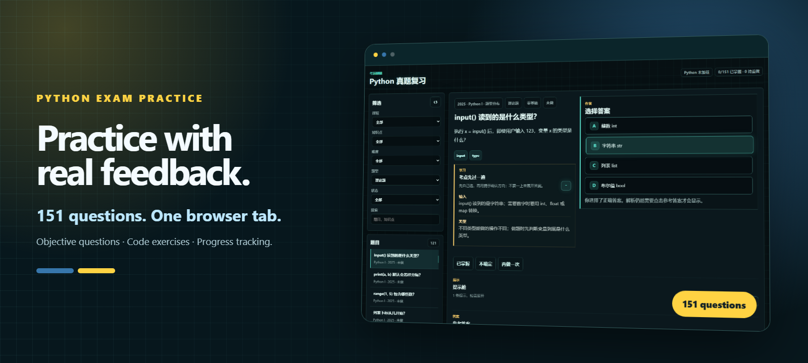
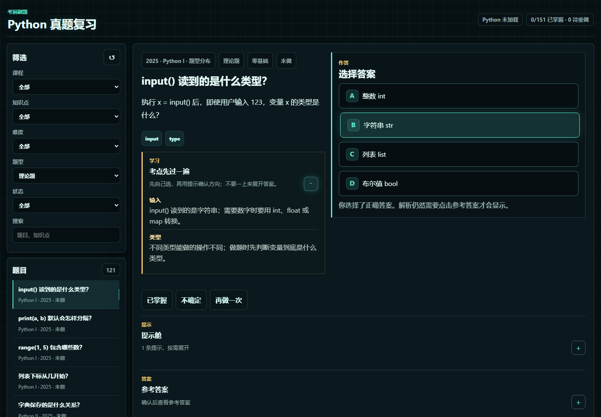
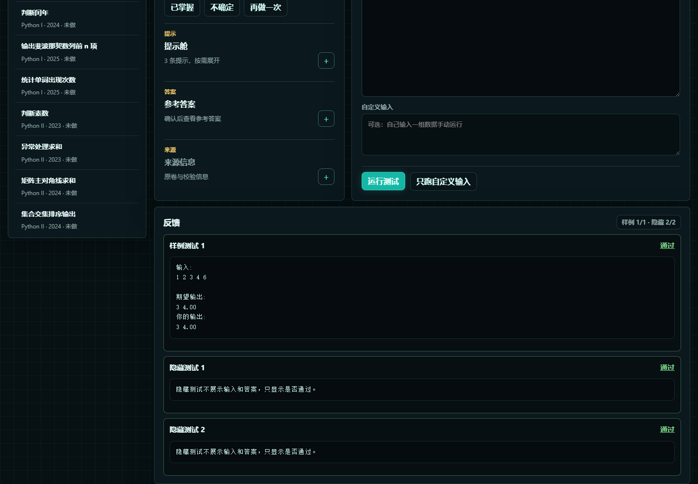
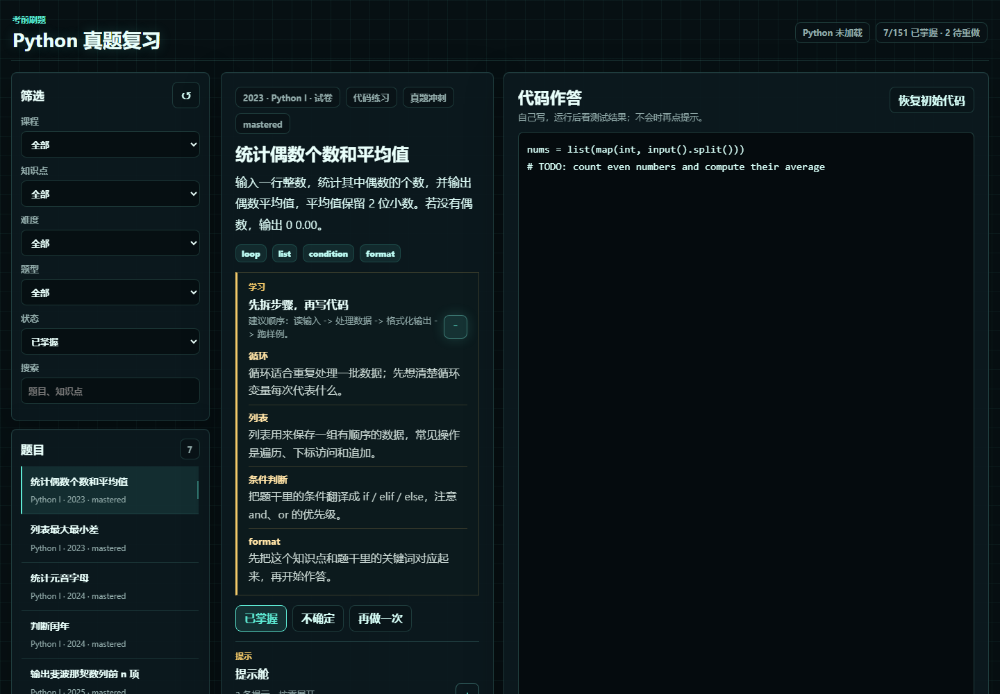
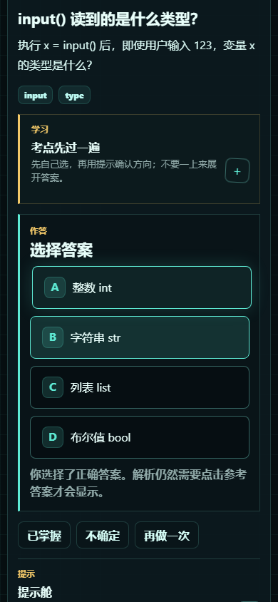

# Python 真题冲刺练习

<p align="center">
  
</p>

<p align="center">
  <a href="https://xiaotian69.github.io/python-exam-practice/"></a>
  
  
  <a href="LICENSE"></a>
</p>

面向 Python I / II 复习的纯静态刷题站：把客观题、填空题和可运行的代码练习放进同一个浏览器工作台，并在本地保存学习进度。

> A browser-based Python exam practice workspace with objective questions, Pyodide code exercises, and local progress tracking.

## Try it online / 在线练习

直接打开：**[xiaotian69.github.io/python-exam-practice](https://xiaotian69.github.io/python-exam-practice/)**

无需注册或安装。题库和进度都在浏览器端处理；代码题首次运行时需要联网加载 Pyodide。

## What is included / 题库构成

当前 [`data/questions.json`](data/questions.json) 共 **151 道题**：

| 构成 | 数量 | 细分 |
| --- | ---: | --- |
| 原卷客观题 | 125 | 87 道单选、5 道多选、21 道判断、12 道填空 |
| 代码练习 | 18 | 12 道真题编程题、6 道入门代码题 |
| 补充理论题 | 8 | 输入输出、容器、异常、函数等基础概念 |
| **合计** | **151** | Python I 77 道、Python II 74 道 |

题目年份覆盖 2023—2025；可按课程、知识点、难度、题型和作答状态筛选。

## Features / 功能亮点

- 一站式练习：选择、判断、填空和代码题共享统一界面。
- 逐层提示：先看考点雷达，再按需展开提示、答案和来源。
- 浏览器运行 Python：代码题包含样例测试、隐藏测试和自定义输入。
- 学习进度：将“已掌握 / 不确定 / 再做一次”等状态保存在 `localStorage`。
- 无构建步骤：原生 HTML、CSS、JavaScript，可直接部署到 GitHub Pages。
- 响应式布局：桌面端适合集中刷题，移动端也能随时练习。

## Screenshots / 界面展示

| 客观题练习 | 代码运行与测试 |
| --- | --- |
|  |  |

| 进度筛选 | 移动端练习 |
| --- | --- |
|  |  |

## How code exercises work / 代码题运行方式

代码题通过 [`src/runner.js`](src/runner.js) 从 jsDelivr 加载 Pyodide `0.26.4`，在浏览器中执行 Python，不会把代码提交到后端服务器。

1. 编辑器先载入题目的初始代码。
2. 点击“运行测试”后依次执行公开样例和隐藏测试。
3. 样例会展示输入、期望输出与实际输出；隐藏测试只展示通过情况。
4. 也可以填写“自定义输入”，单独运行并查看标准输出或错误信息。

首次运行需要下载浏览器版 Python 运行环境，耗时取决于网络；随后通常可复用浏览器缓存。

## Local preview / 本地预览

在仓库根目录启动静态文件服务器：

```powershell
python -m http.server 8000
```

然后访问 [http://localhost:8000](http://localhost:8000)。不要直接双击 [`index.html`](index.html)，否则浏览器可能阻止 `fetch()` 读取 JSON 题库。

项目没有安装或构建步骤。修改 [`index.html`](index.html)、[`styles.css`](styles.css)、[`src/`](src/) 或 [`data/`](data/) 后刷新页面即可。

## Repository structure / 仓库结构

```text
.
├── index.html                 # 应用入口与页面结构
├── styles.css                 # 主题、布局与响应式样式
├── src/
│   ├── app.js                 # 界面状态、筛选与交互
│   ├── progress.js            # localStorage 学习进度
│   ├── questions.js           # 题目筛选、判题与学习提示
│   ├── runner.js              # Pyodide 加载与 Python 执行
│   └── runner-utils.js        # 输出比较与运行结果汇总
├── data/
│   ├── questions.json         # 正式题库
│   ├── exam_objective_questions.json
│   └── sources.json           # 来源索引与校验信息
└── docs/assets/               # README 展示图及可复现视觉源文件
```

## Data sources and learning-use notice / 数据来源与学习用途

题库中的部分题目整理自历年试卷、评分参照和题型分布资料；来源索引及文件校验信息记录在 [`data/sources.json`](data/sources.json)。补充练习、界面文案和程序实现由本项目组织与编写。

本仓库用于个人学习、复习与教学演示，不主张对第三方试题、试卷或评分资料的所有权。相关内容的权利归原权利人所有；如有权利或勘误问题，请通过仓库 Issue 联系处理。使用者应自行确认其使用方式符合适用规则。

## License

软件代码和项目原创的界面呈现采用 [MIT License](LICENSE)。该许可不延伸至仓库中可能包含的第三方试题、试卷、评分参照或其他来源内容；这些内容仍受其各自权利条款约束。
